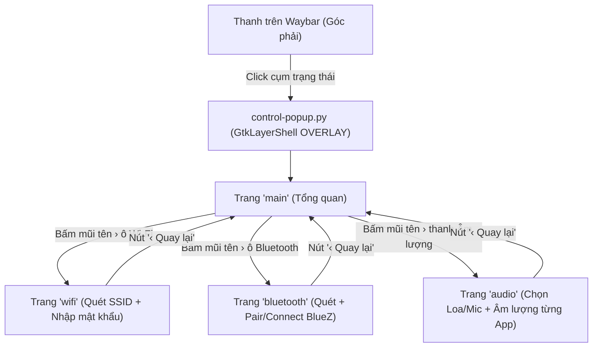

# Phân tích bố cục Waybar & thiết kế popup (Gemini, 2026-11-18)

> Gemini (Antigravity) phân tích + tìm trên web; Claude đã làm theo phần C (control-popup.py). Số đo toạ độ trong báo cáo là ước lượng, số thật xem CLAUDE.md.

---

## PHẦN A. Phân tích cấu trúc Waybar hiện tại (`config.jsonc` & `style.css`)

Hệ thống hiện chạy **2 thanh Waybar** (`layer: "top"`) ghép sát mép màn hình tạo thành **khung chữ L**:
- **`topbar`** (thanh ngang trên cùng, cao `40px`, kéo dài toàn chiều ngang màn hình).
- **`dockbar`** (thanh dọc bên phải, rộng `60px`, nối liền ngay dưới ô góc `#custom-corner` của thanh trên).

### 1. Bảng liệt kê toàn bộ module của 2 thanh và hành động hiện tại

#### a) Thanh trên (`topbar` — `height: 40`)

| Vùng | Module | Hiển thị | Chuột trái (`on-click`) | Chuột phải / Giữa / Cuộn | Nhận xét |
| :--- | :--- | :--- | :--- | :--- | :--- |
| **Trái** | `custom/launcher` *(trong `group/kafka`)* | `󰣇  Kafka` | Mở `walker` (app launcher) | Phải: `desktop-mode.sh toggle` (chuyển Cuộn ↔ Desktop) | Trùng chức năng mở `walker` với `custom/apps` trên dock; chuột phải trùng với `custom/layoutmode`. |
| **Trái** | `custom/layoutmode` *(trong `group/kafka`)* | Icon chế độ bố cục (`signal: 14`) | `desktop-mode.sh toggle` | — | Hợp lý khi đi kèm khối `group/kafka`. |
| **Trái** | `hyprland/workspaces` | Số La Mã `I`–`X` + icon app đang mở (`window-rewrite`) | Chuyển tới workspace | Cuộn: đổi workspace | Tốt, rõ ràng. |
| **Trái** | `custom/columns` | Bản đồ cột layout cuộn (`▮`, `▤`, `signal: 15`) | Đổi cỡ cột (`colresize +conf`) | Cuộn lên/xuống: focus cột trái/phải | Đặc trưng của layout cuộn, nên giữ nguyên. |
| **Trái** | `network#speed` | `󰇚 Down  󰕒 Up` (`min-length: 24`) | Mở `kitty --class kafka-nmtui -e nmtui-connect` | — | **Mở app terminal (`nmtui`)**; trùng hành động click với `network#dock`. |
| **Giữa** | `clock` | `󰥔 %H:%M   󰃭 %a, %d/%m` | Mở/đóng `clock-popup.py` | — | **Đã là popup GTK3 chuẩn**, hoạt động tốt. |
| **Giữa** | `mpris` | Icon trạng thái + `{title} — {artist}` | `playerctl play-pause` | Cuộn lên/xuống: `playerctl next` / `previous` | Tiện xem nhanh, nhưng thiếu thanh tua/ảnh bìa/chọn nguồn phát. |
| **Phải** | `pulseaudio` | `{icon} {volume}%` / `Muted` | `pkill -x pavucontrol \|\| pavucontrol` | Phải: `wpctl set-mute @DEFAULT_AUDIO_SINK@ toggle` · Cuộn: đổi âm lượng | **Mở app rời (`pavucontrol`)** thay vì popup chọn loa/mic & thanh trượt. |
| **Phải** | `backlight` | `{icon} {percent}%` | *(Không có)* | Cuộn lên/xuống: `brightnessctl s 5%+` / `5%-` | Chiếm 1 viên thuốc riêng chỉ để cuộn chuột. |
| **Phải** | `group/system` (`cpu`, `memory`, `temperature`) | `󰻠 %` · `󰍛 %` · `󰔏 °C` | Cả 3 đều gọi `toggle-app.sh kafka-btop kitty --class kafka-btop -e btop` | — | Gộp chung 1 viên thuốc là hợp lý; mở `btop` là đúng mục đích giám sát sâu. |
| **Phải** | `battery` | `{icon} {capacity}%` | `power-profile.sh` (xoay vòng chế độ nguồn + `notify-send`) | — | Phải bấm mò theo vòng tròn, không nhìn thấy ngay đang ở chế độ nguồn nào. |
| **Phải** | `idle_inhibitor` | `󰅶` (bật) / `󰾪` (tắt) | Bật/tắt giữ sáng màn hình | — | Chiếm 1 ô riêng trên thanh trên, ít khi bấm nhưng luôn hiển thị. |
| **Phải** | `custom/notifications` | `󰂚`/`󰂛` + số thông báo (`dunstctl`, `signal: 10`) | `dunstctl history-pop` | Phải: `dunstctl history-clear` | Chưa có nút bật/tắt Không làm phiền (DND) tại chỗ (DND lại nằm bên `tools-popup.py`). |
| **Phải** | `custom/corner` | `󰯊` (ô góc nối thanh trên với dock) | Bật/tắt scratchpad `magic` (`Super + S`) | — | Điểm neo thị giác của khung chữ L, bắt buộc giữ. |

#### b) Thanh dọc bên phải (`dockbar` — `width: 60`)

| Vùng (trên → dưới) | Module | Hiển thị | Chuột trái (`on-click`) | Chuột phải / Giữa / Rê chuột | Nhận xét |
| :--- | :--- | :--- | :--- | :--- | :--- |
| **Đầu dock (`modules-left`)** | `network#dock` *(trong `group/status`)* | Icon sóng Wi-Fi / Ethernet (`24px`) | Mở `kitty --class kafka-nmtui -e nmtui-connect` | Phải: `nmcli radio wifi on/off` | **Mở app terminal (`nmtui`)**; trùng với `network#speed` trên thanh trên. |
| **Đầu dock** | `bluetooth#dock` *(trong `group/status`)* | Icon Bluetooth `󰂯`/`󰂲`/`󰂱` | Mở `blueman-manager` qua `toggle-app.sh` | Phải: `rfkill block/unblock bluetooth` | **Mở app GUI nặng (`blueman-manager`)**. |
| **Đầu dock** | `custom/ime` *(trong `group/status`)* | `VI` / `EN` / `󰌌` (`ime-status.sh`) | `fcitx5-remote -t` (đổi VI ↔ EN) | Phải: `fcitx5-configtool` | Nhỏ gọn, thao tác 1-click chuẩn, nhưng đặt ở dock dễ lệch bố cục với nhóm hệ thống. |
| **Đầu dock** | `custom/apps` | `󰀻` (ô gradient Kafka) | Mở `walker` | — | **Trùng hoàn toàn** với `custom/launcher` ở góc trái thanh trên. |
| **Đầu dock** | `custom/tools` | Icon công cụ / `REC` / DND (`signal: 12`) | Daemon `tools-popup.py` phủ hotspot tại `y=241..289` | Rê chuột / bấm: mở popup ngang (Clipboard, Chụp/quay, Phím tắt, DND) | Toạ độ hotspot đang **gán cứng (`HOT_TOP = 241`)**; nếu thêm/bớt nút phía trên là lệch vùng nhận chuột. |
| **Đầu dock** | `group/pinned` | 5 icon: Chromium, Kitty, Thunar, VS Code, Mousepad | `setsid -f <app>` | — | Hợp lý cho dock. |
| **Đầu dock** | `tray` | Khay hệ thống (`ignore-list`: `nm-applet`, `Fcitx`) | Tuỳ app trong khay | — | Hợp lý. |
| **Giữa dock (`modules-center`)** | `group/windows` | `custom/hidden` + `image#w1`..`w10` (`dock-apps.py`) | `custom/hidden`: menu ẩn/hiện; `image#wN`: focus/xoay vòng cửa sổ | Phải (`hidden`): hiện tất cả; Giữa (`wN`): đóng cửa sổ | Phần cốt lõi của dock dọc, rất tốt. |
| **Đáy dock (`modules-right`)** | `custom/actions` *(trong `group/actions`)* | `󰍜` (`32px`) | `actionsmenu.sh` (sóng nhạc, treo, nổi/xếp, đóng app, chia khu, khóa) | — | Hợp lý ở đáy dock. |
| **Đáy dock** | `custom/powermenu` *(trong `group/actions`)* | `󰐥` (`32px`) | `powermenu.sh` | — | Hợp lý ở đáy dock. |

---

### 2. Đánh giá: Module trùng/thừa, nhóm cần gộp và bố cục nên đổi

1. **Module trùng lặp / dư thừa:**
   - **Wi-Fi xuất hiện 2 lần** (`network#speed` ở thanh trên và `network#dock` ở đầu dock), cả 2 đều gọi `nmtui-connect`.
   - **Nút mở `walker` xuất hiện 2 lần** (`custom/launcher` đầu thanh trên và `custom/apps` đầu dock). Nếu bỏ `custom/apps` (hoặc giữ `custom/apps` trên dock cho người dùng chuột phải màn hình, nhưng bỏ `network#dock` và `bluetooth#dock`), dock sẽ thoáng hơn rất nhiều.
   - **Trạng thái DND (Không làm phiền)** bị tách làm 2 nơi: hiển thị ở `custom/notifications` (thanh trên) và cả ở `custom/tools` / `tools-popup.py` (dock).
2. **Sự phân mảnh của nhóm "Trạng thái & Cài đặt phần cứng":**
   - Hiện tại **Âm lượng, Độ sáng, Pin, Giữ sáng màn hình** nằm trên `topbar`, còn **Wi-Fi, Bluetooth, Bộ gõ** lại nằm ở `dockbar` (`group/status`). Người dùng phải nhìn 2 hướng khác nhau để kiểm tra trạng thái máy.
   - Hơn nữa, `dockbar` theo chiều dọc `1080px` đang phải chứa quá nhiều nút cố định (3 nút `status` + `apps` + `tools` + 5 `pinned` + `tray` + `actions` = 12+ ô ngoài danh sách cửa sổ đang mở).
3. **Đề xuất gộp & đổi bố cục:**
   - **Chuyển toàn bộ trạng thái hệ thống lên góc phải `topbar`**, gom **Wi-Fi + Bluetooth + Âm lượng + Độ sáng + Pin (kèm chế độ nguồn) + Giữ sáng (Caffeine) + Không làm phiền (DND)** vào một cụm/viên thuốc duy nhất trên thanh trên (hoặc module tổng hợp `custom/control-center` / `group/control-center`) để bấm bất kỳ đâu trong cụm đều mở **Popup Trung tâm điều khiển (Control Center)** (hoặc mở đúng tab tương ứng).
   - **Giải phóng đầu `dockbar`**: Bỏ `network#dock` và `bluetooth#dock` khỏi đầu dock. Chuyển `custom/ime` (`VI`/`EN`) lên thanh trên (cạnh cụm cài đặt nhanh) hoặc giữ ở đầu dock tuỳ thói quen, giúp `dockbar` chuyên tâm làm **Dock ứng dụng & cửa sổ** (`apps` · `tools` · `pinned` · `windows` · `tray` · `actions`).

---

## PHẦN B. Khảo sát cách các Shell cho Niri / Hyprland và công cụ Waybar làm Popup

### 1. Bảng tổng hợp các Desktop Shell hiện đại (Niri / Hyprland)

| Shell / Dự án | Công nghệ nền | Thành phần trong Popup (Control Center / Quick Settings) | Mở ở đâu (Vị trí neo) | Cách đóng | Bố cục (Layout) |
| :--- | :--- | :--- | :--- | :--- | :--- |
| **Noctalia** (`noctalia-dev/noctalia`) | Quickshell (Qt6 / QML) | • **Wi-Fi**: Bật/tắt (trái), mở tab danh sách SSID + nhập mật khẩu + 802.1X (phải)<br>• **Bluetooth**: Bật/tắt, quét, ghép đôi (pair), tin cậy (trust), kết nối qua BlueZ<br>• **Âm thanh**: Thanh trượt loa/mic, chọn thiết bị ra/vào<br>• **Độ sáng**: Thanh trượt (backlight / `ddcutil`)<br>• **Nguồn**: Đổi `power_profile` + menu nguồn<br>• **Media & Lịch**: Tích hợp tóm tắt MPRIS, lịch | Góc trên phải (dưới thanh bar) hoặc gọi qua IPC `noctalia msg panel-toggle control-center [tab]` | Bấm ra ngoài (overlay catch), nhấn `Esc`, hoặc gọi lại lệnh toggle | **Khung đơn chia Tab/Sidebar** (`full`, `compact` icon, hoặc `none`): Trang chính (Home) chứa lưới nút Quick Toggles + thanh trượt; bấm mở rộng/chuyển tab sang trang con (Wi-Fi, BT, Audio). |
| **DankMaterialShell (DMS)** (`AvengeMedia` / `duxlabs-dev`) | Quickshell (QML) + Go | • **Wi-Fi**: Quét/kết nối/nhập mật khẩu (NetworkManager/`iwd`)<br>• **Bluetooth**: Quét, pair, connect trực tiếp<br>• **Âm thanh**: Thanh trượt tổng + từng ứng dụng (per-app stream), đổi sink/source<br>• **Độ sáng & Nguồn**: Thanh trượt sáng, đổi `power-profiles-daemon`<br>• **Khác**: MPRIS media, lịch, thời tiết, lịch sử clipboard | Góc trên phải (dưới cụm status của thanh trên) | Bấm ra ngoài, nhấn `Esc`, hoặc bấm lại nút trên thanh | **Material Design 3 Card**: Trên cùng là các viên thuốc (pills) 2 nửa (bấm icon = bật/tắt nhanh, bấm mũi tên/chữ = bung danh sách inline hoặc sang trang con); dưới là sliders + MPRIS. |
| **Caelestia Shell** (`caelestia-dots/shell`) | Quickshell (QML) | • **Quick Toggles**: Wi-Fi, Bluetooth, DND, Idle inhibitor, chế độ nguồn<br>• **Sliders**: Âm lượng, độ sáng<br>• **Media & Dashboard**: Trình phát MPRIS có hiệu ứng, biểu đồ CPU/RAM, thời tiết, lịch | Trượt từ cạnh trên (slide-down dashboard) gắn liền với thanh bar | Bấm ra ngoài vùng dashboard, nhấn `Esc`, hoặc phím tắt | **Unified Dashboard đa cột**: Cột lịch/thời tiết, cột media/hiệu năng, và cột Quick Settings (lưới nút tròn/viên thuốc + thanh trượt). |
| **HyprPanel** (`Jas-SinghFSU/HyprPanel`) | AGS / Astal (GTK3 + GJS/TypeScript) | Tách thành **Dashboard** + **các Menu rơi độc lập**:<br>• `networkmenu`: Danh sách Wi-Fi, nhập mật khẩu<br>• `bluetoothmenu`: Bật/tắt, quét, pair/connect, % pin thiết bị<br>• `audiomenu`: Thanh trượt loa/mic, chọn thiết bị, âm lượng từng app<br>• `energy/brightness`: Thanh trượt sáng + 3 mức `power-profiles-daemon`<br>• `mediamenu` & `dashboardmenu`: Lịch, MPRIS, thông số máy | Neo ngay **bên dưới module vừa bấm** trên thanh trên (`audiomenu`, `networkmenu`, `bluetoothmenu` riêng; `dashboardmenu` ở góc) | Lớp phủ toàn màn hình bắt sự kiện click-outside (`Window` phủ 4 cạnh) hoặc nhấn `Esc` | **Nhiều popup chuyên biệt theo từng nút** + 1 Dashboard tổng hợp. Mỗi menu rộng ~300–360px, có tiêu đề, nút gạt (Switch) và `Gtk.ScrolledWindow` chứa danh sách. |
| **end-4 `illogical-impulse` & `iNiR`** | Quickshell (trước đây là AGS) | • **Wi-Fi & Bluetooth**: Nút bật/tắt nhanh + trang danh sách mạng/thiết bị ngay trong sidebar<br>• **Âm thanh & Độ sáng**: Thanh trượt + chọn thiết bị PipeWire/WirePlumber<br>• **Nguồn**: Chuyển `powerprofilesctl`<br>• **Media & Thông báo**: Danh sách thông báo, MPRIS kèm sóng nhạc | **Sidebar dọc bên phải** (trượt từ mép phải màn hình ra) | Bấm ra ngoài sidebar, nhấn `Esc`, hoặc phím tắt (`Super + N` / click góc) | **Right Sidebar (Thanh bên phải cao kịch trần)**: Chia khối trên (Sliders + Quick Toggles), khối giữa (Tab Thông báo / Wi-Fi / Bluetooth / Audio), khối dưới (Media/System). |

### 2. Bảng tổng hợp các công cụ Popup cho Waybar

| Công cụ | Kiểu giao diện | Phạm vi chức năng | Mở ở đâu & Cách đóng | Ưu / Nhược điểm với Kafka |
| :--- | :--- | :--- | :--- | :--- |
| **`networkmanager-dmenu` / `iwmenu` / `bzmenu` / `rofi-bluetooth`** | Menu danh sách văn bản (dùng Rofi / Walker / Fuzzel) | • `networkmanager-dmenu`: Chọn Wi-Fi, nhập mật khẩu qua prompt rofi, bật/tắt mạng.<br>• `rofi-bluetooth` / `bzmenu`: Quét, pair, connect Bluetooth (thường gọi `bluetoothctl` hoặc D-Bus). | Giữa màn hình hoặc góc (tuỳ theme Rofi); đóng bằng `Esc` hoặc click ra ngoài | **Nhược điểm**: Chỉ là danh sách chữ đơn điệu, không có thanh trượt âm lượng/độ sáng, không gộp được thành Control Center; `rofi-bluetooth` phụ thuộc `bluetoothctl` (máy hiện **KHÔNG** có `bluetoothctl`). |
| **`swaync` (SwayNotificationCenter)** | GTK3 + `gtk-layer-shell` | Danh sách thông báo + các widget ghép thêm (`buttons-grid`, `volume`, `backlight`, `mpris`, `menubar`). | Cạnh phải màn hình; đóng khi click ra ngoài / `Esc` | **Nhược điểm**: Máy **KHÔNG** cài `swaync` (đang dùng `dunst`); `swaync` không có sẵn danh sách quét Wi-Fi/nhập mật khẩu hay danh sách Bluetooth nếu không mở app ngoài. |
| **`nwg-panel`** | Python + GTK3 + `gtk-layer-shell` | Có plugin **Controls** (popup ghép thanh trượt âm lượng, độ sáng, pin, chuyển đổi nhanh, thông số máy). | Neo dưới thanh panel; đóng khi mất focus / click ngoài | **Nhược điểm**: Máy **KHÔNG** cài `nwg-panel`; phần chọn Wi-Fi/Bluetooth của `nwg-panel` vẫn phải gọi lệnh ngoài (`nmtui`/`blueman`). |
| **Popup tự viết bằng `GTK3 + gtk-layer-shell` (như `clock-popup.py`, `tools-popup.py`)** | Python (`PyGObject`) + GTK3 + `GtkLayerShell 0.1` | Tuỳ biến 100%: Thanh trượt (`Gtk.Scale`), lưới nút (`Gtk.Grid`), chuyển trang mượt (`Gtk.Stack`), ô nhập mật khẩu (`Gtk.Entry`), danh sách cuộn (`Gtk.ScrolledWindow`). | Neo chính xác theo toạ độ layer-shell; phủ lớp trong suốt 4 cạnh để bắt click-outside + `Esc` | **Phù hợp tuyệt đối**: Có sẵn đầy đủ thư viện trên máy (`python-gobject 3.58.1`, `gtk-layer-shell 0.10.1`, `libnm 1.58.1`), đồng bộ 100% bảng màu rượu vang Kafka. |

---

## PHẦN C. Đề xuất kiến trúc Popup cho Kafka

### 1. Lựa chọn kiến trúc: Một "Trung tâm điều khiển" (Control Center) có các trang con (`Gtk.Stack`)

> **Quyết định thiết kế:** Chọn **1 Popup Trung tâm điều khiển hợp nhất (`control-popup.py`)** sử dụng `Gtk.Stack` gồm **Trang chính (`main`)** và **3 Trang con (`wifi`, `bluetooth`, `audio`)**, đồng thời cho phép mở thẳng vào trang con bằng tham số dòng lệnh (`control-popup.py [main|wifi|bluetooth|audio]`).

#### Lý do chọn kiến trúc hợp nhất (giống Noctalia / DankMaterialShell) thay vì nhiều popup rời:
1. **Đã có mẫu thành công trong chính repo Kafka:** `tools-popup.py` đang dùng `Gtk.Stack` để chuyển giữa trang `"main"` và trang `"shot"` (6 kiểu chụp/quay) ngay trong một cửa sổ mà không bị nhấp nháy hay mất vị trí neo.
2. **Tránh xung đột lớp phủ (Overlay):** Kiểu đóng "bấm ra ngoài" của `clock-popup.py` dùng cửa sổ `OVERLAY` neo cả 4 cạnh màn hình với `KeyboardMode.EXCLUSIVE`. Nếu tách 4–5 file popup rời, phải quản lý nhiều PID file và xử lý việc bấm từ nút này sang nút kia khi 1 popup đang giữ exclusive grab. Với **1 tiến trình `control-popup.py` duy nhất**, mọi thao tác chuyển đổi giữa Wi-Fi ↔ Bluetooth ↔ Âm thanh ↔ Độ sáng ↔ Nguồn diễn ra tức thì trong cùng một khung.
3. **Vẫn hỗ trợ bấm từng biểu tượng trên thanh trên:** Nếu trên Waybar người dùng bấm vào biểu tượng Âm lượng, lệnh `control-popup.py audio` có thể mở thẳng trang Âm thanh (hoặc mở trang chính có sẵn thanh trượt âm lượng); bấm vào Wi-Fi mở `control-popup.py` (hoặc `control-popup.py wifi`).
4. **Không bị đè lên Dock dọc bên phải:** Vì bên phải màn hình đã có `dockbar` (`width: 60px`), nếu làm Sidebar dọc như `iNiR` sẽ đè lên hoặc xung đột thị giác với `dockbar`. Một khung **Control Center thả xuống từ góc trên-phải của `topbar` (cách mép phải `72px` để né `dockbar` `60px`)** là vừa vặn và tự nhiên nhất với khung chữ L.



---

### 2. Cơ chế Cửa sổ, Vị trí neo và Cách đóng

- **Kiểu tiến trình:** Khởi chạy theo yêu cầu (on-demand) kèm PID file tại `$XDG_RUNTIME_DIR/kafka-control-popup.pid` (giống hệt `clock-popup.py`):
  - Nếu chưa chạy → tạo cửa sổ, ghi PID.
  - Nếu đang chạy và gọi cùng trang → gửi `SIGTERM` để đóng (toggle).
  - Nếu đang chạy mà gọi trang khác (vd đang ở `main` bấm nút `audio`) → gửi tín hiệu hoặc đổi trang (hoặc đóng/mở lại trang đó).
- **Cấu hình `GtkLayerShell`:**
  - `GtkLayerShell.set_namespace(win, "kafka-control")`
  - `GtkLayerShell.set_layer(win, GtkLayerShell.Layer.OVERLAY)`
  - Neo cả 4 cạnh (`TOP`, `BOTTOM`, `LEFT`, `RIGHT` = `True`) để tạo tấm chắn trong suốt toàn màn hình.
  - `GtkLayerShell.set_exclusive_zone(win, -1)`
  - `GtkLayerShell.set_keyboard_mode(win, GtkLayerShell.KeyboardMode.EXCLUSIVE)` (để nhận phím `Esc` và nhập mật khẩu Wi-Fi vào `Gtk.Entry`).
- **Vị trí đặt khung `.panel` bên trong cửa sổ toàn màn hình:**
  - `panel` đặt `halign = Gtk.Align.END`, `valign = Gtk.Align.START`.
  - `margin_top = 48` (ngay dưới `topbar` cao `40px` + khe hở `8px`).
  - `margin_end = 70` (bên trái `dockbar` rộng `60px` + khe hở `10px`, đảm bảo không che khuất `dockbar`).
  - Chiều rộng cố định của `.panel`: `360px` (`set_size_request(360, -1)`).
- **Cách đóng:**
  1. **Bấm ra ngoài khung `.panel`:** Bắt sự kiện `button-press-event` trên `Gtk.Window`, kiểm tra `self.panel.get_allocation()` như `clock-popup.py` — nếu toạ độ `(ev.x, ev.y)` nằm ngoài khung `.panel` thì gọi `self.quit()`.
  2. **Nhấn phím `Esc`:** Bắt `key-press-event` (`ev.keyval == Gdk.KEY_Escape`): nếu đang ở trang con (`wifi`, `bluetooth`, `audio`) thì quay về trang `main` (hoặc đóng luôn nếu đang ở `main`).
  3. **Bấm lại vào nút trên Waybar:** Phát hiện qua `PIDFILE` → thoát.

---

### 3. Nội dung cụ thể và Nguồn dữ liệu (API / Lệnh chính xác) cho từng trang

#### Trang 1: Trang chính (`main`) — Cài đặt nhanh & Thanh trượt

| Khối giao diện | Thành phần chi tiết | Hành động người dùng | Nguồn dữ liệu / API / Lệnh chính xác trên máy |
| :--- | :--- | :--- | :--- |
| **1. Lưới 2x2 Nút Gạt Nhanh (Split Pills)** | • **Ô Wi-Fi** (Nửa trái: Icon + tên mạng SSID đang nối hoặc "Tắt"; Nửa phải: nút `›`)<br>• **Ô Bluetooth** (Nửa trái: Icon + tên thiết bị đang nối hoặc "Đang bật"/"Tắt"; Nửa phải: nút `›`)<br>• **Ô Không làm phiền (DND)** (Icon `󰂚`/`󰂛` + trạng thái)<br>• **Ô Giữ sáng (Caffeine)** (Icon `󰅶`/`󰾪` + trạng thái) | • Bấm nửa trái Wi-Fi: bật/tắt radio Wi-Fi<br>• Bấm `›` Wi-Fi: sang trang `wifi`<br>• Bấm nửa trái BT: bật/tắt nguồn BT<br>• Bấm `›` BT: sang trang `bluetooth`<br>• Bấm DND: bật/tắt thông báo<br>• Bấm Giữ sáng: bật/tắt chặn idle | • **Wi-Fi**: `gi.require_version('NM', '1.0'); from gi.repository import NM` → `client.wireless_get_enabled()` / `client.wireless_set_enabled(bool)` (hoặc `nmcli radio wifi on/off`).<br>• **Bluetooth**: D-Bus hệ thống `org.bluez` trên `/org/bluez/hci0`, interface `org.freedesktop.DBus.Properties` → đọc/ghi property `Powered` (`GLib.Variant('b', True/False)`) của `org.bluez.Adapter1`. Nếu bị soft-block thì gọi thêm `rfkill unblock bluetooth`.<br>• **DND**: `dunstctl is-paused` và `dunstctl set-paused toggle; pkill -RTMIN+10 waybar; pkill -RTMIN+12 waybar`.<br>• **Giữ sáng**: Quản lý tiến trình `systemd-inhibit --what=idle --who=Kafka --why="Control Center" sleep infinity` (kiểm tra bằng `pgrep -f "systemd-inhibit.*Kafka"`). |
| **2. Khối Thanh trượt (Sliders)** | • **Thanh Âm lượng Loa**: Nút icon Loa (bấm để Mute) + `Gtk.Scale` (0–100%) + nút `›` (mở trang `audio`)<br>• **Thanh Âm lượng Mic**: Nút icon Mic (bấm để Mute) + `Gtk.Scale` (0–100%)<br>• **Thanh Độ sáng**: Icon mặt trời + `Gtk.Scale` (5–100%) | • Kéo thanh trượt (debounce `40ms` bằng `GLib.timeout_add`)<br>• Bấm icon đầu dòng để Mute/Unmute<br>• Bấm `›` cạnh thanh loa để chọn thiết bị ra/vào | • **Đọc âm lượng**: `wpctl get-volume @DEFAULT_AUDIO_SINK@` (trả về dạng `Volume: 0.57` hoặc `Volume: 0.57 [MUTED]`) và `@DEFAULT_AUDIO_SOURCE@`.<br>• **Đặt âm lượng**: `wpctl set-volume @DEFAULT_AUDIO_SINK@ 57%` / `wpctl set-mute @DEFAULT_AUDIO_SINK@ toggle`.<br>• **Đọc độ sáng**: `brightnessctl -m` (trả về CSV: `device,class,cur,percent%,max` → lấy cột 4 bỏ `%`).<br>• **Đặt độ sáng**: `brightnessctl set 60%`. |
| **3. Thanh Chế độ nguồn & Pin (Power Profile Bar)** | • Hàng trên: Icon pin + `%` + trạng thái (`Đang sạc` / `Còn X giờ Y phút`) + công suất tiêu thụ (`W`)<br>• Hàng dưới: 3 nút chọn phân đoạn (Segmented buttons):<br>  `[ 󰾆 Tiết kiệm ] [ 󰾅 Cân bằng ] [ 󰓅 Hiệu năng ]` | Bấm vào 1 trong 3 nút sẽ chuyển ngay sang chế độ đó và tô sáng nút đang chọn (viền vàng `#d4af6a`, nền `#b8326a`) | • **Đọc/Đặt chế độ nguồn**: `powerprofilesctl get` (trả về `power-saver`, `balanced`, hoặc `performance`) và `powerprofilesctl set <profile>` (hoặc gọi D-Bus `net.hadess.PowerProfiles` / `org.freedesktop.UPower.PowerProfiles` *(tên bus tuỳ bản daemon, dùng `powerprofilesctl` là chắc chắn 100% vì đã xác minh trong `power-profile.sh`)*).<br>• **Chi tiết Pin**: D-Bus hệ thống `org.freedesktop.UPower` tại `/org/freedesktop/UPower/devices/DisplayDevice` (interface `org.freedesktop.UPower.Device`): đọc các property `Percentage` (double), `State` (1=Charging, 2=Discharging, 4=FullyCharged), `TimeToEmpty` (int64 giây), `TimeToFull` (int64 giây), `EnergyRate` (double W). |
| **4. Khối Media rút gọn (Mini MPRIS)** *(ẩn khi không có trình phát)* | • Tên bài hát + Nghệ sĩ + tên trình phát<br>• 3 nút: `󰒮` (Prev) · `󰐊/󰏤` (Play/Pause) · `󰒭` (Next) | Bấm điều khiển nhạc trực tiếp | • **Đọc trạng thái**: `playerctl metadata --format '{{status}}\t{{playerName}}\t{{title}}\t{{artist}}'`<br>• **Điều khiển**: `playerctl previous`, `playerctl play-pause`, `playerctl next`. |

---

#### Trang 2: Trang con Wi-Fi (`wifi`) — Quét mạng, Kết nối & Nhập mật khẩu tại chỗ

- **Bố cục:**
  1. **Header:** Nút `‹ Quay lại` | Tiêu đề `Wi-Fi` | Nút `󰑐 Quét lại` | Công tắc `Gtk.Switch` bật/tắt Wi-Fi.
  2. **Mạng đang kết nối (nếu có):** Hiển thị nổi bật ở đầu danh sách (Icon sóng + `SSID` + băng tần/tốc độ + địa chỉ IPv4 + nút `Ngắt kết nối`).
  3. **Danh sách mạng khả dụng (`Gtk.ScrolledWindow`, cao tối đa `280px`):**
     - Gom nhóm theo `SSID` (chỉ lấy Access Point có `strength` cao nhất cho mỗi `SSID`, bỏ qua SSID rỗng).
     - Mỗi dòng gồm: Icon cột sóng (`󰤯`..`󰤨` theo `%`) + Icon ổ khoá `󰌾` (nếu có bảo mật WPA/WEP) + Tên `SSID` + Huy hiệu `Đã lưu` (nếu đã có profile trong NetworkManager).
  4. **Hộp nhập mật khẩu nội tuyến (`Gtk.Revealer` ngay dưới dòng mạng vừa bấm):**
     - Khi bấm vào một mạng:
       - Nếu mạng **Đã lưu** hoặc **Mở (Open)**: kết nối ngay lập tức.
       - Nếu mạng **Có khoá & Chưa lưu**: mở `Gtk.Revealer` ngay dưới dòng đó gồm `Gtk.Entry(visibility=False)` (có nút con mắt hiện/ẩn mật khẩu) + nút `Kết nối` (hoặc nhấn `Enter` trong ô nhập).
       - Hiển thị trạng thái `Đang kết nối...` hoặc báo lỗi `Sai mật khẩu / Kết nối thất bại` ngay trong popup, **không cần mở `nmtui`**.
- **Nguồn dữ liệu & Lệnh chính xác:**
  - **Đọc danh sách Access Point (nhanh, không giật UI) qua `libnm` (`gi.repository.NM`):**
    ```python
    gi.require_version("NM", "1.0")
    from gi.repository import NM

    client = NM.Client.new(None)
    # Lấy thiết bị Wi-Fi:
    wifi_devs = [d for d in client.get_devices() if d.get_device_type() == NM.DeviceType.WIFI]
    # Yêu cầu quét nền (bất đồng bộ):
    wifi_dev.request_scan_async(None, on_scan_finished, None)
    # Lấy danh sách Access Point:
    aps = wifi_dev.get_access_points()
    # Với mỗi ap:
    ssid_bytes = ap.get_ssid()  # GLib.Bytes
    ssid = NM.utils_ssid_to_utf8(ssid_bytes.get_data()) if ssid_bytes else ""
    strength = ap.get_strength()  # int 0..100
     secured = (ap.get_flags() != getattr(NM._80211ApFlags, "NONE", 0)) or (ap.get_wpa_flags() != 0) or (ap.get_rsn_flags() != 0)
    # Kiểm tra các kết nối đã lưu:
    saved_conns = client.get_connections() # lọc theo s_wifi.get_ssid()
    ```
  - **Thực hiện kết nối / ngắt kết nối / quên mạng:**
    - Có thể dùng `NM.Client.activate_connection_async` / `add_and_activate_connection_async`, **HOẶC** gọi bất đồng bộ (`Gio.Subprocess` / `subprocess.Popen` kèm callback) qua `nmcli` để đơn giản hoá việc tạo profile WPA-PSK:
      - Kết nối mạng đã lưu / mạng mở: `nmcli device wifi connect "<SSID>"`
      - Kết nối mạng mới có mật khẩu: `nmcli device wifi connect "<SSID>" password "<PASSWORD>"`
      - Ngắt kết nối: `nmcli device disconnect <ifname>`
      - Xoá (Quên) mạng đã lưu: `nmcli connection delete id "<SSID>"`

---

#### Trang 3: Trang con Bluetooth (`bluetooth`) — Quét, Ghép đôi & Kết nối qua D-Bus BlueZ

> **Lưu ý quan trọng:** Máy **KHÔNG** có `bluetoothctl` (theo `cong-cu-tren-may.txt`). Do đó mọi thao tác Bluetooth bắt buộc giao tiếp trực tiếp với daemon `bluetoothd` qua **System D-Bus (`org.bluez`)** bằng `Gio.DBusConnection` (có sẵn trong `python-gobject`).

- **Bố cục:**
  1. **Header:** Nút `‹ Quay lại` | Tiêu đề `Bluetooth` | Nút `󰑐 Quét (10s)` | Công tắc `Gtk.Switch` bật/tắt Bluetooth.
  2. **Nhóm "Thiết bị đã ghép đôi (Paired)":**
     - Mỗi dòng: Icon loại thiết bị (`󰋋` tai nghe, `󰍽` chuột, `󰌌` bàn phím, `󰄜` điện thoại) + Tên (`Alias`) + `% Pin` (nếu thiết bị có báo qua `org.bluez.Battery1`) + Nút hành động (`Kết nối` / `Ngắt` màu vàng/hồng) + Nút nhỏ `󰆴` (Xoá/Bỏ ghép đôi).
  3. **Nhóm "Thiết bị khả dụng mới tìm thấy":**
     - Hiện khi bấm nút `Quét`, bấm vào tên thiết bị sẽ gọi `Pair()` → đặt `Trusted = True` → gọi `Connect()`.
- **Nguồn dữ liệu & API D-Bus `org.bluez` chính xác (qua `gi.repository.Gio`):**
  - **Kết nối System Bus & Lấy toàn bộ Adapter + Device trong 1 lệnh:**
    ```python
    from gi.repository import Gio, GLib

    bus = Gio.bus_get_sync(Gio.BusType.SYSTEM, None)
    # Gọi GetManagedObjects trên ObjectManager tại "/"
    res = bus.call_sync(
        "org.bluez", "/", "org.freedesktop.DBus.ObjectManager",
        "GetManagedObjects", None, GLib.VariantType("(a{oa{sa{sv}}})"),
        Gio.DBusCallFlags.NONE, -1, None
    )
    objects = res.unpack()[0]
    ```
  - **Xử lý Adapter (`/org/bluez/hci0`, interface `org.bluez.Adapter1`):**
    - Đọc trạng thái nguồn: `objects["/org/bluez/hci0"]["org.bluez.Adapter1"]["Powered"]`
    - Bật/tắt nguồn:
      - Nếu bật: kiểm tra/mở khoá `rfkill unblock bluetooth` trước, sau đó gọi `org.freedesktop.DBus.Properties.Set("org.bluez.Adapter1", "Powered", GLib.Variant("b", True))`.
    - Bắt đầu / Dừng quét thiết bị:
      - Gọi method `StartDiscovery()` và `StopDiscovery()` trên `/org/bluez/hci0` (interface `org.bluez.Adapter1`). Tự động gọi `StopDiscovery()` sau 10 giây hoặc khi đóng popup/rời trang.
  - **Xử lý từng Thiết bị (`/org/bluez/hci0/dev_XX_XX_...`, interface `org.bluez.Device1`):**
    - Các thuộc tính đọc từ dictionary `org.bluez.Device1`:
      - `Alias` (str: tên hiển thị), `Address` (str: MAC), `Icon` (str: `audio-headset`, `input-mouse`...), `Paired` (bool), `Connected` (bool), `Trusted` (bool), `RSSI` (int16, nếu đang quét).
    - Đọc `% Pin` (nếu object có thêm interface `org.bluez.Battery1`):
      - `objects[dev_path]["org.bluez.Battery1"]["Percentage"]` (byte `0..100`).
    - Các method bất đồng bộ (`bus.call(...)` với timeout 15–30s để không đơ giao diện):
      - **Kết nối:** Method `Connect()` trên `org.bluez.Device1`.
      - **Ngắt kết nối:** Method `Disconnect()` trên `org.bluez.Device1`.
      - **Ghép đôi mới:** Method `Pair()` trên `org.bluez.Device1` → trong callback thành công, gọi `Properties.Set("org.bluez.Device1", "Trusted", GLib.Variant("b", True))` rồi gọi `Connect()`. *(Lưu ý: với tai nghe/chuột/loa thông thường sử dụng `NoInputNoOutput` capability thì `Pair()` tự hoàn tất; nếu thiết bị yêu cầu nhập mã PIN phức tạp thì cần đăng ký `org.bluez.Agent1` hoặc báo người dùng — ghi chú cho lập trình viên đăng ký một `Agent1` đơn giản `NoInputNoOutput` nếu cần).*
      - **Xoá thiết bị (Forget):** Method `RemoveDevice(GLib.Variant("(o)", (dev_path,)))` trên `/org/bluez/hci0` (`org.bluez.Adapter1`).

---

#### Trang 4: Trang con Âm thanh (`audio`) — Chọn thiết bị Ra/Vào & Âm lượng từng ứng dụng

- **Bố cục:**
  1. **Header:** Nút `‹ Quay lại` | Tiêu đề `Âm thanh`.
  2. **Khối "Thiết bị đầu ra (Loa / Tai nghe)":**
     - Danh sách các Sink đang có (nút chọn dạng radio `󰄬` cho thiết bị mặc định + tên mô tả + thanh trượt hoặc `%`). Bấm vào dòng nào thì chuyển thiết bị mặc định sang dòng đó.
  3. **Khối "Thiết bị đầu vào (Microphone)":**
     - Danh sách các Source đang có (trừ các `.monitor`). Bấm để đổi mic mặc định.
  4. **Khối "Ứng dụng đang phát âm thanh (Sink Inputs)":**
     - Mỗi ứng dụng (vd: Chromium, MPV) có 1 dòng gồm Tên ứng dụng + nút Mute + `Gtk.Scale` chỉnh âm lượng riêng cho ứng dụng đó.
- **Nguồn dữ liệu & Lệnh chính xác (`pactl -f json` & `wpctl`):**
  - Trên máy có sẵn cả `/usr/bin/pactl` (của `pipewire-pulse`) và `/usr/bin/wpctl`. Dùng **`pactl -f json`** là cách sạch và chuẩn xác nhất trong Python vì trả về JSON hoàn chỉnh, không phải cắt chuỗi thủ công:
    - **Lấy thiết bị mặc định:**
      ```bash
      pactl -f json info
      ```
      *(Đọc khoá `"default_sink_name"` và `"default_source_name"`).*
    - **Lấy danh sách Loa/Tai nghe (Sinks):**
      ```bash
      pactl -f json list sinks
      ```
      *(Mỗi phần tử có `"index"`, `"name"`, `"description"`, `"mute"`, và `"volume"`).*
    - **Lấy danh sách Mic (Sources):**
      ```bash
      pactl -f json list sources
      ```
      *(Lọc bỏ các phần tử có `"monitor_of_sink" != null`).*
    - **Lấy danh sách Ứng dụng đang phát (Sink Inputs):**
      ```bash
      pactl -f json list sink-inputs
      ```
      *(Mỗi phần tử có `"index"`, `"properties": {"application.name": ..., "media.name": ...}`, `"mute"`, `"volume"`).*
    - **Các lệnh điều khiển khi người dùng bấm/kéo:**
      - Đổi thiết bị ra mặc định: `pactl set-default-sink <name>`
      - Đổi thiết bị vào mặc định: `pactl set-default-source <name>`
      - Chỉnh âm lượng ứng dụng: `pactl set-sink-input-volume <index> <percent>%`
      - Tắt tiếng ứng dụng: `pactl set-sink-input-mute <index> toggle`

---

### 4. Đề xuất bố cục mới của Thanh trên (`topbar`) và Dock dọc (`dockbar`) sau khi có Popup

#### a) Thanh trên (`topbar`) — Gom gọn góc phải thành cụm Cài đặt nhanh

Thay vì 6 viên thuốc rời rạc (`pulseaudio`, `backlight`, `battery`, `idle_inhibitor`, `custom/notifications` trên thanh trên + `network#dock`, `bluetooth#dock`, `custom/ime` dưới dock), ta sắp xếp lại như sau:

| Vùng | Thứ tự Module mới (Trái → Phải) | Thay đổi so với hiện tại & Hành động |
| :--- | :--- | :--- |
| **`modules-left`** | 1. `group/kafka` (`custom/launcher` + `custom/layoutmode`)<br>2. `hyprland/workspaces`<br>3. `custom/columns`<br>4. `network#speed` | • Giữ nguyên bố cục trái.<br>• Đổi `on-click` của `network#speed` từ mở `nmtui` sang `~/.config/hypr/scripts/control-popup.py wifi` (bấm vào tốc độ mạng là mở ngay trang chọn Wi-Fi của popup). |
| **`modules-center`** | 1. `clock`<br>2. `mpris` | • Giữ nguyên (`clock` mở `clock-popup.py`; `mpris` điều khiển nhạc nhanh). |
| **`modules-right`** | 1. `group/system` (`cpu` · `memory` · `temperature`)<br>2. `custom/ime` *(chuyển từ đầu dock lên)*<br>3. **`group/control`** *(Viên thuốc Cài đặt nhanh gộp: `network#top` · `bluetooth#top` · `pulseaudio` · `backlight` · `battery`)*<br>4. `custom/notifications`<br>5. `custom/corner` | • **`group/system`**: Giữ nguyên (bấm mở `btop`).<br>• **`custom/ime`**: Hiển thị `VI`/`EN` ngay trên thanh trên, dễ nhìn khi gõ phím.<br>• **`group/control`** (1 viên thuốc liền mạch giống `group/system`):<br>  - `network#top` (chỉ hiện icon sóng) → Trái: `control-popup.py wifi` · Phải: bật/tắt Wi-Fi.<br>  - `bluetooth#top` (chỉ hiện icon BT, ẩn khi tắt hoặc hiện mờ) → Trái: `control-popup.py bluetooth` · Phải: bật/tắt BT.<br>  - `pulseaudio` (`{icon} {volume}%`) → Trái: `control-popup.py audio` · Phải: mute · Cuộn: âm lượng.<br>  - `backlight` (`{icon} {percent}%`) → Trái: `control-popup.py main` · Cuộn: độ sáng.<br>  - `battery` (`{icon} {capacity}%`) → Trái: `control-popup.py main` · Phải: `power-profile.sh`.<br>• **Bỏ `idle_inhibitor` rời** trên thanh trên (đã chuyển vào nút Giữ sáng trong `control-popup.py`).<br>• **`custom/notifications`** và **`custom/corner`**: Giữ nguyên ở cuối thanh. |

#### b) Thanh phải (`dockbar`) — Tinh gọn thành Dock ứng dụng thuần tuý

Sau khi chuyển Wi-Fi, Bluetooth, Bộ gõ lên `group/control` của thanh trên, `dockbar` được giải phóng ~130px chiều cao, không còn bị chật khi mở nhiều cửa sổ:

| Vùng (Trên → Dưới) | Thứ tự Module mới | Thay đổi so với hiện tại |
| :--- | :--- | :--- |
| **`modules-left`** (Đầu dock) | 1. `custom/apps` (`󰀻` Walker)<br>2. `custom/tools` (`tools-popup.py`)<br>3. `group/pinned` (5 app ghim)<br>4. `tray` | • **Xoá `group/status` (`network#dock`, `bluetooth#dock`, `custom/ime`)** khỏi đầu dock.<br>• **Lưu ý kỹ thuật bắt buộc khi xoá `group/status`:** Trong `tools-popup.py`, nút `custom/tools` đôn từ vị trí thứ 5 lên vị trí thứ 2 (ngay dưới `custom/apps`). Cần cập nhật lại hằng số toạ độ hotspot trong `tools-popup.py`: `HOT_TOP` giảm từ `241` xuống khoảng `104` (`POP_TOP` giảm tương ứng từ `216` xuống `80`) *(cần chụp `grim` đo lại pixel chính xác sau khi áp dụng CSS)*. |
| **`modules-center`** (Giữa dock) | 1. `group/windows` (`custom/hidden` + `image#w1`..`image#w10`) | • Giữ nguyên, có thêm không gian dọc nên ít phải thu nhỏ icon qua `dock-density.sh`. |
| **`modules-right`** (Đáy dock) | 1. `group/actions` (`custom/actions` + `custom/powermenu`) | • Giữ nguyên. |

---

### 5. Bảng màu & Quy tắc CSS cho `control-popup.py` (Đồng bộ tuyệt đối với `style.css` & `clock-popup.py`)

Để lập trình viên áp dụng trực tiếp vào hằng số `CSS` trong `control-popup.py`:

| Thành phần | Thuộc tính CSS chuẩn Kafka |
| :--- | :--- |
| **Khung chính (`.panel`)** | `background-color: rgba(26, 13, 24, 0.97); border: 2px solid #b8326a; border-radius: 20px; padding: 16px;` |
| **Ô nút gạt nhanh (`.tile`)** | `background-color: rgba(58, 21, 48, 0.55); border: 1px solid #5e2f57; border-radius: 14px; padding: 10px 12px;` |
| **Ô nút đang bật (`.tile.active`)** | `background-image: linear-gradient(135deg, #8f2456 0%, #b8326a 55%, #9b4dca 100%); border-color: #d4af6a; color: #ffffff;` |
| **Khi rê chuột (`.tile:hover`, `.row:hover`)** | `background-color: #4a1c3d; border-color: #c77dff;` |
| **Thanh trượt (`scale trough` / `highlight`)** | `trough { background-color: #2b1d3a; border-radius: 999px; min-height: 8px; }`<br>`highlight { background-image: linear-gradient(90deg, #b8326a, #c77dff); border-radius: 999px; }`<br>`slider { background-color: #f4eef8; border: 2px solid #b8326a; border-radius: 999px; min-width: 16px; min-height: 16px; }` |
| **Chữ phụ / Nhãn mờ (`.sub`)** | `color: #a99bbd; font-size: 9pt;` |
| **Điểm nhấn vàng (`.gold`)** | `color: #d4af6a;` |
| **Vạch ngăn (`.sep`)** | `min-height: 1px; background-color: #3b1a33; margin: 6px 0;` |

---

### 6. Lộ trình triển khai dành cho Lập trình viên (Từng bước)

1. **Bước 1 — Viết `~/.config/hypr/scripts/control-popup.py`:**
   - Khởi tạo khung `Gtk.Window` + `GtkLayerShell` (lớp `OVERLAY`, neo 4 cạnh, bắt click-outside và `Esc`, quản lý `PIDFILE` tại `$XDG_RUNTIME_DIR/kafka-control-popup.pid` như `clock-popup.py`).
   - Dựng `Gtk.Stack` với 4 trang: `main`, `wifi`, `bluetooth`, `audio`. Nhận `sys.argv[1]` (mặc định `"main"`) để mở thẳng trang được gọi.
   - Cài đặt backend cho từng trang:
     - Trang `main`: `wpctl`, `brightnessctl -m`, `powerprofilesctl`, `dunstctl`, `systemd-inhibit`, `playerctl`, `UPower` D-Bus.
     - Trang `wifi`: `gi.repository.NM` (`NM.Client`) để liệt kê/quét AP + `nmcli device wifi connect` chạy bất đồng bộ kèm `Gtk.Revealer` nhập mật khẩu.
     - Trang `bluetooth`: `Gio.bus_get_sync(Gio.BusType.SYSTEM)` gọi `org.bluez` (`GetManagedObjects`, `StartDiscovery`, `Pair`, `Connect`, `Disconnect`, `RemoveDevice`).
     - Trang `audio`: `pactl -f json list sinks/sources/sink-inputs` và `pactl set-default-sink/source`.
2. **Bước 2 — Cập nhật `config.jsonc` và `style.css`:**
   - Tạo `group/control` ở `modules-right` của `topbar`, trỏ `on-click` của mạng/bluetooth/âm thanh/độ sáng/pin vào `control-popup.py [wifi|bluetooth|audio|main]`.
   - Bỏ `group/status` ở đầu `dockbar`, chuyển `custom/ime` lên `topbar`.
   - Bổ sung CSS cho `#control` trên `topbar` (giống `#system` với vạch ngăn `#5e2f57` giữa các biểu tượng).
3. **Bước 3 — Cập nhật toạ độ hotspot trong `tools-popup.py`:**
   - Đo lại vị trí Y mới của nút `custom/tools` trên `dockbar` (sau khi bỏ `group/status`) và cập nhật `HOT_TOP`, `POP_TOP`.
