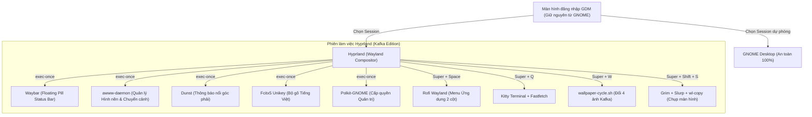

# Kế hoạch 01: Ý tưởng Thiết kế & Kiến trúc Xây dựng Hệ thống (Architecture & Design System)

## 1. Ý tưởng Chủ đạo (Core Concept): "Kafka's Web under the Rain"

Khi tự xây dựng một môi trường Desktop trên Arch Linux từ con số 0 (thay vì dùng DE đóng gói sẵn như GNOME/KDE hay các bản dotfiles cồng kềnh), bài toán lớn nhất là **Sự đồng nhất thị giác (Visual Cohesion)** và **Trải nghiệm sử dụng hàng ngày (Daily Usability)**.

Lấy cảm hứng từ bức họa **Kafka (Honkai: Star Rail)** cầm chiếc ô đen bước đi giữa cơn mưa tím cùng những sợi tơ nhện mảnh sắc bén:

* **Nền tảng (Atmosphere):** Màu đen tím than (`#141118`) của những chiếc ô kết hợp với hiệu ứng kính mờ (`blur` 3 lớp, `vibrancy 0.22`) tạo cảm giác như nhìn qua lớp sương mưa.
* **Sợi tơ điều khiển (The Spider Threads):** Viền cửa sổ đang mở (`col.active_border`) là một dải màu chuyển động liên tục (`borderangle` loop) giữa **Đỏ rượu vang (`#b8326a`)**, **Tím tia chớp (`#c77dff`)** và **Vàng đồng (`#d4af6a`)**, giúp mắt người dùng lập tức nhận diện cửa sổ đang focus mà không cần thanh tiêu đề (titlebar).
* **Các hòn đảo nổi (Floating Islands):** Thanh trạng thái **Waybar** không đóng khung cứng nhắc toàn bộ mép trên màn hình mà tách thành từng cụm viên thuốc (`border-radius: 999px`) lơ lửng, để lộ tối đa hình nền nghệ thuật phía sau.

---

## 2. Sơ đồ Kiến trúc Các Thành phần (Component Architecture)

Trong một Tiling Window Manager như Hyprland, mỗi chức năng được đảm nhiệm bởi một công cụ chuyên biệt (Unix Philosophy: *"Mỗi chương trình chỉ làm một việc nhưng làm thật tốt"*):

---

## 3. Quy trình Xây dựng Từng Lớp (How It Was Built Layer-by-Layer)

### Lớp 1: Xử lý Tư liệu Hình ảnh (Asset Pipeline)
* Bức ảnh gốc người dùng yêu cầu (`kafka_main.jpg`) có tỷ lệ dọc (`900x1600`).
* Nếu ép giãn (stretch) hoặc cắt (crop) trực tiếp lên màn hình Laptop 16:9 (`1920x1080`), bức ảnh sẽ bị mất đầu/chân hoặc méo hình.
* **Giải pháp kỹ thuật:**
  1. Dùng `ImageMagick` tạo một lớp nền `1920x1080` phóng to từ ảnh gốc, làm mờ Gaussian (`0x28`) và phủ lớp màu tím tối (`#140e1c` ở mức `45%`).
  2. Đặt bức ảnh dọc sắc nét có đóng khung viền đỏ rượu (`#b8326a` dày `3px`) vào chính giữa $\rightarrow$ tạo ra `kafka_umbrella_1080p.jpg`.
  3. Tận dụng luôn ảnh dọc gốc `kafka_main.jpg` làm **Banner cột trái cho Rofi Launcher** và **Logo hiển thị trong Fastfetch**.
  4. Bổ sung thêm 3 bức hình nền ngang 16:9 độ phân giải cao (`kafka_landscape_1..3`) để người dùng đổi gió chỉ với phím `Super + W`.

### Lớp 2: Cấu hình Lõi Hyprland (`hypr/hyprland.conf`)
* Thiết lập `gaps_in = 6`, `gaps_out = 12` để các cửa sổ có khoảng thở, làm nổi bật hình nền và hiệu ứng bóng đổ (`shadow range = 20`).
* Tích hợp sẵn các phím chức năng phần cứng của Laptop:
  * Âm lượng: `wpctl` (PipeWire原生, nhẹ và tức thời).
  * Độ sáng màn hình: `brightnessctl`.
  * Bàn di chuột (Touchpad): Cuộn tự nhiên (`natural_scroll`), chạm để click (`tap-to-click`), và vuốt 3 ngón để chuyển Workspace (`workspace_swipe`).

### Lớp 3: Giao diện Người dùng (Waybar, Rofi, Kitty, Dunst)
* Tất cả đều dùng chung font `FiraCode Nerd Font` để hiển thị chuẩn xác các biểu tượng hệ thống (Arch logo `󰣇`, CPU `󰻠`, RAM `󰍛`, Pin `󰁹`, Mạng nhện `🕸`).
* Quản lý tập trung qua cơ chế **Symlink (`ln -sfn`)** từ `<thư mục repo>` vào `~/.config/`, giúp dễ dàng sao lưu lên GitHub hoặc chỉnh sửa trực tiếp trong IDE.
